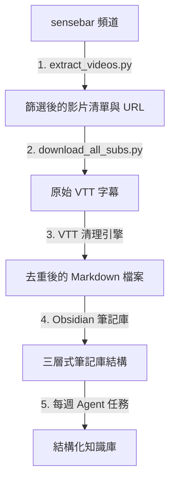

# AI Agent YouTube 字幕知識庫建置工具 (Agent 協作指南)

本儲存庫概述了 AI Agent 的自動化工作流：從 YouTube 頻道提取字幕、解析與清理逐字稿、建置結構化的三層式 Obsidian 第二大腦資料庫，並將其應用於自動化教案與教學規劃。

> [!NOTE]
> 本指南專為 AI Agent 開發助理（如 Claude Code, Codex, AntiGravity, OpenCode）設計。若您是讀取此儲存庫的 Agent，請遵循以下說明並執行腳本來重建此知識庫。

---

## 🗺️ 系統架構

---

## 🛠️ 逐步實作工作流

### 步驟 1：篩選頻道影片並提取 URL
使用 Python 腳本 `extract_videos.py` 從目標 YouTube 頻道的「影片」與「直播」分頁抓取影片中繼資料（依影片 ID 去重），依據特定關鍵字（`claude`, `codex`, `antigravity`, `opencode`, `agent`, `googlea`）進行篩選，並匯出純文字的 URL 清單。

*   **腳本**：`extract_videos.py`
*   **輸出**：`sensebar_ai_urls.txt`

### 步驟 2：下載字幕並清理 VTT
使用腳本 `download_all_subs.py` 循環讀取提取的 URL，利用 `yt-dlp` 下載字幕並清理輸出。

*   **腳本中實作的清理規則**：
    1.  移除 VTT 元資料檔頭與時間戳記（例如 `00:00:01.000 --> 00:00:03.000`）。
    2.  移除 HTML/XML 標籤（例如 `<c>`, `</c>`, `<00:00:01.000>`）。
    3.  **滾動式去重**：YouTube 自動字幕會產生重複的滾動文字。本腳本執行連續行去重演算法，生成流暢易讀的逐字稿段落。
    4.  輸出乾淨的 Markdown 檔案，將影片標題作為 H1，並包含指向原始 YouTube 影片的連結。

### 步驟 3：建立三層式 Obsidian 筆記庫
將目標 Obsidian 筆記庫（Agent 的「第二大腦」）規劃為三個不同的資料夾：
1.  `Clippings/`（外部剪藏）：存放所有生成的字幕 Markdown 檔案。**請勿手動修改這些原始檔案。**
2.  `創作庫/`（個人創作）：存放您自己的教案、講義草稿與原創筆記。
3.  `知識庫/`（結構知識）：完全由 Agent 維護。此處存放結構化的知識、索引以及主題資料夾。

### 步驟 4：執行每週 Agent 重整（Agent 系統提示詞）
作為 Agent，排程每週的定期任務（例如每週日）來執行「每週知識重整」：
1.  掃描 `Clippings/` 與 `創作庫/` 中的新檔案。
2.  消化字幕逐字稿，擷取核心摘要、關鍵字與主題。
3.  將結構化筆記寫入/追加至 `知識庫/` 中對應的資料夾（如 `AI工作流/`、`教學趨勢/`）。
4.  執行健康檢查（Lint）以尋找內容矛盾、無效連結或缺失的交叉引用，並在 Obsidian 關係圖譜（Graph View）中進行對照。
5.  更新全域的 `Index` 與 `Log` 筆記以記錄變更。

### 步驟 5：處理教學檔案並撰寫教案（下游任務）
當知識庫建立完成後：
*   **撰寫教學與課程計畫**：將學校的計畫範本與書商的教學大綱放入資料夾，指示 Agent 讀取這兩個檔案，並自動合併填寫範本。
*   **自動下載與 OCR**：指示 Agent 搜尋網路上的考題 PDF（例如「國中教育會考」），下載並利用 OCR 讀取題目，將其整理成新的學習單。
*   **網頁版互動駕駛艙（教學駕駛艙）**：要求 Agent 將整理出的講稿與投影片編譯成互動式 HTML 網頁（包含嵌入影片、計時器、畫布板與隨堂測驗），並公開部署於 GitHub Pages。

---

## 📄 本儲存庫中的腳本

腳本位於工作區根目錄：
*   [extract_videos.py](extract_videos.py)
*   [download_all_subs.py](download_all_subs.py)

---

## 🤖 執行 Agent 說明
1.  複製此儲存庫。
2.  安裝 Python 依賴套件：使用 `uv` 執行 `uv pip install yt-dlp` 或直接 `pip install yt-dlp`。
3.  執行 `python extract_videos.py` 來提取目標影片。
4.  執行 `python download_all_subs.py` 來建立 `subtitles/` 資料夾。
5.  建立 Obsidian 資料夾（`Clippings`, `創作庫`, `知識庫`），並將 `subtitles/` 中的內容複製到 `Clippings/` 中。
6.  載入您的系統提示詞以維護此三層式知識庫。
